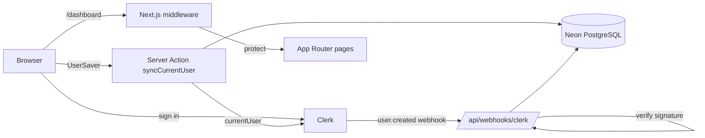

# ReelForge

> A workspace for creating short-form videos, built on Next.js, Clerk authentication and a Neon/Drizzle data layer.

**Status: early stage.** Authentication, user persistence and the dashboard shell are implemented. Video generation is **not** implemented yet (see [Limitations](#limitations) and [Roadmap](#roadmap)).

## What it does today

- Sign-in and sign-up with [Clerk](https://clerk.com); `/dashboard/*` routes are protected by middleware.
- Mirrors each signed-in user into a PostgreSQL `users` table (on sign-in and via Clerk `user.created`, `user.updated` and `user.deleted` webhooks).
- Dashboard shell: header, side navigation, empty state and a "Create New" page with a topic selector (UI only).
- Error, not-found and loading states, basic security headers, and an accessible dashboard layout (landmarks, heading order, `aria-current`).

## Tech stack

| Area | Choice |
|---|---|
| Framework | Next.js 15 (App Router), React 19 |
| Auth | Clerk (`@clerk/nextjs`), Svix webhook verification |
| Database | PostgreSQL on Neon, Drizzle ORM and Drizzle Kit |
| UI | Tailwind CSS 4, Radix UI primitives, lucide-react |

## Architecture



More detail in [docs/ARCHITECTURE.md](docs/ARCHITECTURE.md).

## Project structure

```
app/
  actions/syncUser.js        server action: sync the signed-in user
  api/webhooks/clerk/        Clerk webhook endpoint (created, updated, deleted)
  dashboard/                 protected pages and components
  sign-in, sign-up/          Clerk auth pages
components/                  UserSaver and UI primitives
configs/                     Drizzle client and schema
lib/users.js                 idempotent user upsert and delete
middleware.js                route protection
tests/                       Vitest unit and component tests
docs/                        architecture, API, roadmap
```

## Getting started

Requirements: Node.js 20+, a PostgreSQL database (Neon recommended) and a Clerk application.

```bash
npm install
cp .env.example .env.local   # then fill in the values
npm run db:push              # create the users table (DATABASE_URL must be set in your shell)
npm run dev
```

Credentials are provided **only through environment variables**; nothing secret is committed. See [`.env.example`](.env.example).

| Variable | Purpose |
|---|---|
| `DATABASE_URL` | PostgreSQL connection string (server-side only) |
| `NEXT_PUBLIC_CLERK_PUBLISHABLE_KEY`, `CLERK_SECRET_KEY` | Clerk keys |
| `CLERK_WEBHOOK_SECRET` | Svix signing secret for the Clerk webhook endpoint |

In the Clerk dashboard, subscribe the endpoint `/api/webhooks/clerk` to `user.created`, `user.updated` and `user.deleted`.

## Scripts

| Script | Description |
|---|---|
| `npm run dev` | Start the dev server |
| `npm run build` / `npm start` | Production build and server |
| `npm run lint` | ESLint (`next/core-web-vitals`) |
| `npm test` | Vitest unit and component tests |
| `npm run format` | Prettier (writes; the existing code is not yet formatted with it) |
| `npm run db:push` | Push the Drizzle schema to the database |
| `npm run db:studio` | Open Drizzle Studio |

## Limitations

- No video generation, topic persistence or video list yet; the topic selector and "Create New" page are UI scaffolding.
- Upgrade and Account pages are not built and are not linked.
- The tests were written without being run in a development environment, and the CI workflow has not been exercised yet. `package-lock.json` predates the test and lint dependencies, so CI uses `npm install` until it is regenerated.
- No Content-Security-Policy and no rate limiting; see [SECURITY.md](SECURITY.md).

## Roadmap

- [ ] Script generation from a chosen topic
- [ ] Video rendering pipeline and storage
- [ ] Persist and list a user's videos
- [ ] Upgrade/subscription flow (the `subscription` column exists, unused)
- [ ] See [docs/ROADMAP.md](docs/ROADMAP.md) for engineering items (lockfile, CSP, integration tests)

## Assets

`public/signin.jpeg` is used as the sign-in illustration and the header logo. Its source and licence are not recorded in this repository; replace it with an asset you own before relying on it commercially.

## More documentation

[docs/index.md](docs/index.md) · [Security policy](SECURITY.md)

## License

[MIT](LICENSE) © 2026 Praneetha Potharaju
