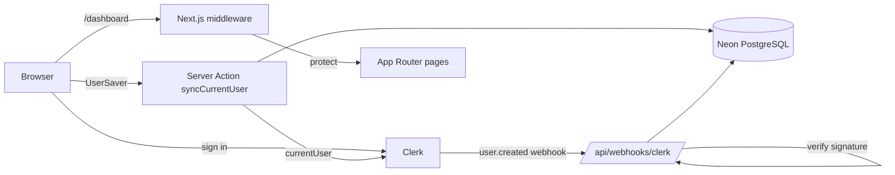

# ReelForge

> A workspace for creating short-form videos, built on Next.js, Clerk authentication and a Neon/Drizzle data layer.

**Status: early stage.** Authentication, user persistence and the dashboard shell are implemented. Video generation is **not** implemented yet (see [Limitations](#limitations) and [Roadmap](#roadmap)).

## What it does today

- Sign-in and sign-up with [Clerk](https://clerk.com); `/dashboard/*` routes are protected by middleware.
- Mirrors each signed-in user into a PostgreSQL `users` table (on first sign-in and via a Clerk `user.created` webhook).
- Dashboard shell: header, side navigation, empty state and a "Create New" page with a topic selector (UI only).

## Tech stack

| Area | Choice |
|---|---|
| Framework | Next.js 15 (App Router), React 19 |
| Auth | Clerk (`@clerk/nextjs`), Svix webhook verification |
| Database | PostgreSQL on Neon, Drizzle ORM and Drizzle Kit |
| UI | Tailwind CSS 4, Radix UI primitives, lucide-react |

## Architecture



More detail in [docs/ARCHITECTURE.md](docs/ARCHITECTURE.md).

## Project structure

```
app/
  actions/syncUser.js        server action: sync the signed-in user
  api/webhooks/clerk/        Clerk webhook endpoint
  dashboard/                 protected pages and components
  sign-in, sign-up/          Clerk auth pages
components/                  UserSaver and UI primitives
configs/                     Drizzle client and schema
lib/users.js                 idempotent user upsert
middleware.js                route protection
```

## Getting started

Requirements: Node.js 20+, a PostgreSQL database (Neon recommended) and a Clerk application.

```bash
npm install
cp .env.example .env.local   # then fill in the values
npm run db:push              # create the users table (DATABASE_URL must be set in your shell)
npm run dev
```

Credentials are provided **only through environment variables**; nothing secret is committed. See [`.env.example`](.env.example).

| Variable | Purpose |
|---|---|
| `DATABASE_URL` | PostgreSQL connection string (server-side only) |
| `NEXT_PUBLIC_CLERK_PUBLISHABLE_KEY`, `CLERK_SECRET_KEY` | Clerk keys |
| `CLERK_WEBHOOK_SECRET` | Signing secret for the `user.created` webhook |

## Scripts

| Script | Description |
|---|---|
| `npm run dev` | Start the dev server |
| `npm run build` / `npm start` | Production build and server |
| `npm run db:push` | Push the Drizzle schema to the database |
| `npm run db:studio` | Open Drizzle Studio |

## Limitations

- No video generation, topic persistence or video list yet; the topic selector and "Create New" page are UI scaffolding.
- `/dashboard/upgrade` and `/dashboard/account` are linked in the side navigation but not built.
- No automated tests and no lint configuration yet; CI runs a production build.

## Roadmap

- [ ] Script generation from a chosen topic
- [ ] Video rendering pipeline and storage
- [ ] Persist and list a user's videos
- [ ] Upgrade/subscription flow (the `subscription` column exists, unused)
- [ ] ESLint and tests

## License

[MIT](LICENSE) © 2026 Praneetha Potharaju
