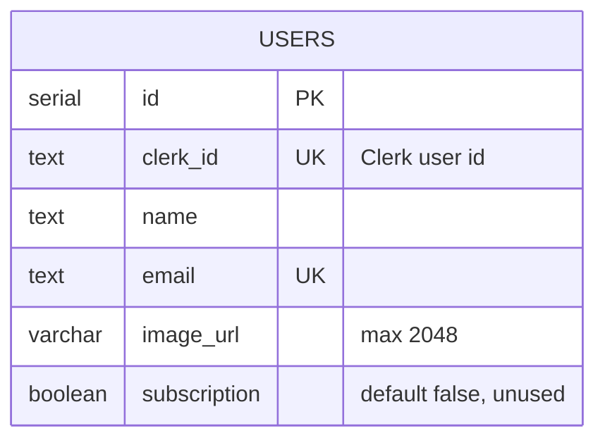

# ReelForge architecture

## Request flow

1. **Routing and auth.** `middleware.js` runs Clerk middleware on all non-static routes and calls `auth.protect()` for `/dashboard(.*)`; unauthenticated visitors are redirected to sign-in.
2. **User sync (client-triggered).** `components/UserSaver.jsx` is mounted once in the root layout. When Clerk reports a signed-in user it calls the `syncCurrentUser` server action.
3. **Server action.** `app/actions/syncUser.js` resolves the user with `currentUser()` from the Clerk session. Identity is never taken from client-supplied fields. It then calls `upsertUser`.
4. **User sync (webhook).** Clerk sends `user.created`, `user.updated` and `user.deleted` to `/api/webhooks/clerk`. The handler verifies the Svix signature against the **raw** request body, then upserts or deletes the row. See [API.md](API.md).
5. **Persistence.** `lib/users.js` inserts into `users` and, on a conflicting `clerk_id`, refreshes email, name and avatar, so repeated sign-ins and webhook retries are idempotent.

## Data model

The email column is unique, so a Clerk user whose email collides with another row fails the write rather than overwriting it.

## Security notes

- The database URL is read from `DATABASE_URL` on the server only. It must never use a `NEXT_PUBLIC_` prefix, which would expose it to browsers.
- The webhook rejects requests without a configured secret, valid Svix headers and a valid signature.
- The route matcher in `middleware.js` is a JavaScript string: the dot in the static-file pattern must be written `\.`. A single backslash is dropped and the pattern then matches no real route.
- Response headers are hardened in `next.config.mjs`. There is no Content-Security-Policy yet; see the [security policy](../SECURITY.md).
- Secrets live in environment variables; `.env*` is git-ignored except `.env.example`.

## Extension points

Video generation would add tables (videos, jobs), a background worker and object storage; none exist yet. See the roadmap in the README.
